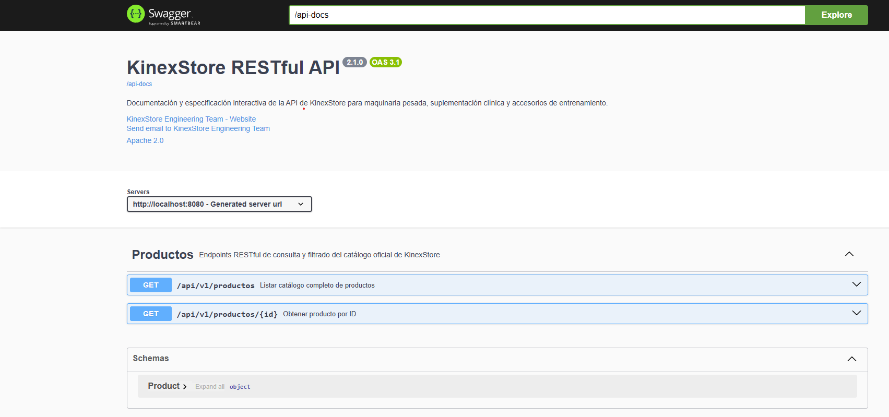
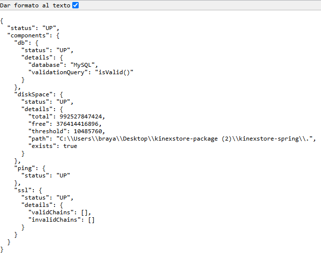
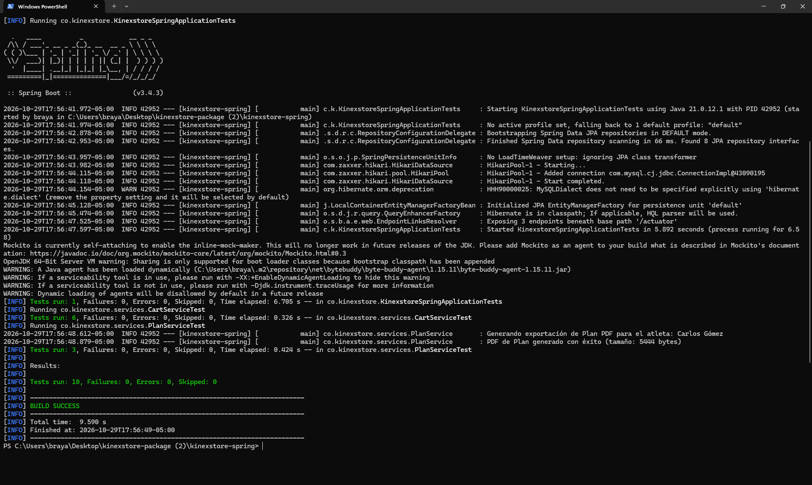
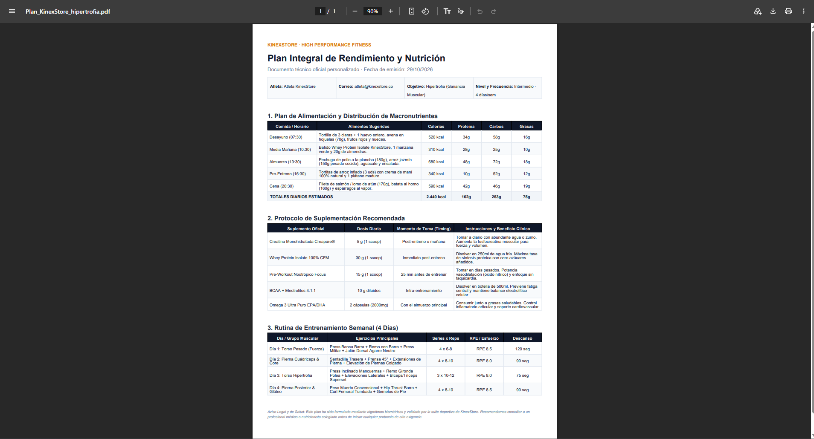

# KinexStore — E-Commerce & Back-Office Platform

Plataforma integral de comercio electrónico y gestión empresarial (Back-Office) de alto rendimiento, orientada a equipamiento pesado de musculación, suplementación deportiva de grado clínico, accesorios de entrenamiento y un motor de prescripción física con exportación de planes personalizados en formato PDF.

Desarrollada bajo **Clean Architecture** sobre **Spring Boot 3.4**, persistencia JPA con Hibernate en **MySQL 8.x**, seguridad criptográfica con **BCrypt**, documentación OpenAPI / **Swagger UI**, telemetría con **Actuator** y contenedorización mediante **Docker Multi-stage Build**.

---

## Índice

1. [Visión General del Sistema](#visión-general-del-sistema)
2. [Arquitectura y Tecnologías](#arquitectura-y-tecnologías)
3. [Módulos Principales](#módulos-principales)
4. [Seguridad y Endurecimiento](#seguridad-y-endurecimiento)
5. [Pruebas Unitarias](#pruebas-unitarias)
6. [API RESTful y Swagger UI](#api-restful-y-swagger-ui)
7. [Monitoreo y Métricas](#monitoreo-y-métricas)
8. [Despliegue con Docker](#despliegue-con-docker)
9. [Instrucciones de Ejecución Local](#instrucciones-de-ejecución-local)
10. [Credenciales y Datos de Prueba](#credenciales-y-datos-de-prueba)
11. [Evidencias y Capturas de Pantalla](#evidencias-y-capturas-de-pantalla)

---

## Visión General del Sistema

KinexStore atiende tres líneas de negocio interconectadas:

1. **Maquinaria Pesada y Ligera (21 Equipos Oficiales):** Racks de potencia, prensas de piernas a 45°, máquinas Smith, poleas cruzadas y estaciones selectorizadas. Incorpora cálculo logístico con flete industrial pesado (>50 kg) y lectura dual de peso internacional (**kg y lbs**).
2. **Suplementación Deportiva (10 Fórmulas Oficiales):** Proteínas aisladas CFM, creatina monohidratada micronizada, pre-entrenos nootrópicos, BCAA fermentados y Omega 3. Integra trazabilidad por número de lote, fecha de vencimiento y registro sanitario legal (INVIMA).
3. **Línea de Accesorios de Entrenamiento (16 Productos):** Cinturones de cuero de potencia, muñequeras de soporte, rodilleras de neopreno de 7mm, correas de agarre (lifting straps), bandas elásticas, shakers y colchonetas de alta densidad.
4. **Prescripción de Planes y Exportación a PDF:** Asistente interactivo que genera un programa físico según objetivo y nivel, permitiendo la descarga inmediata de un documento técnico en PDF estructurado en 3 tablas detalladas (Nutrición y Macros, Suplementación Clínica y Rutina Semanal con RPE).

---

## Arquitectura y Tecnologías

El sistema adopta una arquitectura en capas desacopladas con inversión de dependencias:

- **Lenguaje:** Java 17 LTS / OpenJDK 21
- **Framework Base:** Spring Boot 3.4.3
- **Capa Web & Vistas:** Spring MVC + Tomcat Embebido (Jasper) + JSP + Jakarta JSTL 3.0
- **Estilos:** Tailwind CSS + Vanilla CSS3 responsivo (tema Dark Industrial)
- **Persistencia:** Spring Data JPA + Hibernate ORM
- **Base de Datos:** MySQL 8.x con auto-generación de esquema
- **Seguridad:** Spring Security Crypto (`BCryptPasswordEncoder` con factor de coste 10)
- **Motor de Documentos:** OpenPDF 2.0.3 para generación vectorial en memoria
- **Documentación de APIs:** SpringDoc OpenAPI 3 / Swagger UI 2.8.5
- **Telemetría y Salud:** Spring Boot Actuator
- **Pruebas Automatizadas:** JUnit 5 + Mockito 5
- **Contenedorización:** Docker Multi-stage (Maven 3.9 Alpine -> Temurin JRE 21 Alpine)

---

## Módulos Principales

### 1. Tienda Pública (E-Commerce)
- **Inicio (`/` o `/app`):** Hero visual con video, accesos a categorías (Maquinaria, Suplementos, Accesorios) y carrusel de objetivos.
- **Catálogo de Maquinaria (`/catalogo/equipamiento`):** Filtros dinámicos por tipo de estación, cálculo de peso dual y cotización de flete.
- **Catálogo de Suplementación (`/catalogo/suplementos`):** Filtros por objetivo de nutrición y visualización de registros sanitarios.
- **Catálogo de Accesorios (`/catalogo/accesorios`):** 16 referencias para soporte, agarre, hidratación y entrenamiento funcional.
- **Detalle de Producto (`/producto/{id}`):** Especificaciones técnicas completas y motor de venta cruzada (*cross-selling*).
- **Carrito Persistente (`/carrito`):** Carrito en sesión que calcula subtotales, peso total en kg/lbs y sugiere la modalidad de envío adecuada (Local, Estándar o Pesado).
- **Checkout Seguro (`/checkout`):** Protección de ruta que redirige a login/registro preservando los ítems de compra del usuario.

### 2. Generador y Exportador de Planes (`/planes`)
- Asistente biométrico para capturar edad, peso, estatura, nivel de experiencia, días disponibles y tipo de dieta.
- Generación de informe con recomendaciones personalizadas.
- **Exportación en PDF (`/planes/{id}/pdf`):** Generación limpia en memoria con diseño corporativo KinexStore que incluye:
  - *Tabla 1:* Plan de Alimentación y Macronutrientes (horarios, alimentos, calorías, P/C/G y totales diarios).
  - *Tabla 2:* Protocolo de Suplementación (dosis, timing y justificación fisiológica).
  - *Tabla 3:* Rutina de Entrenamiento Semanal distribuida (ejercicios, series x repeticiones, escala RPE y descansos).

### 3. Back-Office Administrativo (`/admin`)
- **Dashboard Ejecutivo:** KPIs de ventas mensuales, pedidos pendientes, alertas de stock bajo y balance de clientes.
- **Gestión de Maquinaria y Accesorios:** CRUD de catálogo con especificaciones y stock.
- **Control Sanitario de Suplementos:** Semáforo de vencimiento de lotes (Óptimo, Próximo a vencer, Vencido) y auditoría INVIMA.
- **Gestión de Pedidos y Usuarios:** Control de despachos, guías de transporte y conmutación de roles de usuario.

---

## Seguridad y Endurecimiento

- **Almacenamiento de Contraseñas:** Se utiliza `BCryptPasswordEncoder` para hashear de forma unidireccional y con sal aleatoria las contraseñas tanto en el sembrado inicial (`DataInitializer`) como en el registro de nuevos usuarios (`/registro`). Las credenciales nunca se persisten en texto claro.
- **Manejo Centralizado de Excepciones:** Clase `GlobalExceptionHandler` anotada con `@ControllerAdvice`. Resuelve errores de forma desacoplada:
  - Para peticiones web: renderiza la vista `error.jsp` con códigos de estado amigables (400, 404, 500).
  - Para peticiones REST: entrega una respuesta JSON estructurada con marca de tiempo, código HTTP y mensaje de error.
- **Trazabilidad con SLF4J:** Se erradicó el uso de salidas por consola estándar (`System.out.println`), adoptando loggers estructurados de SLF4J con niveles informativos (`INFO`) y de advertencia/error (`WARN`/`ERROR`).

---

## Pruebas Unitarias

La suite de pruebas automatizadas está construida con **JUnit 5** y **Mockito**, garantizando la validación de la lógica de negocio sin acoplamiento a la base de datos real:

- **`CartServiceTest`:**
  - Adición de productos nuevos y acumulación de existencias.
  - Cálculo de subtotales y adición de fletes de transporte (Estándar vs Industrial Pesado).
  - Conversión de pesos duales (kilogramos a libras mediante la constante `2.20462`).
  - Sugerencia automática de flete pesado al superar el umbral de 50 kg.
  - Actualización de cantidades y remoción de ítems.
- **`PlanServiceTest`:**
  - Creación de planes de hipertrofia y persistencia mediante mocks.
  - Validación de coherencia en la descripción según el volumen semanal y nivel atlético.
  - Verificación del binario PDF generado, comprobando la firma de bytes mágicos (`%PDF-`) y un tamaño representativo superior a 5 KB.
- **`KinexstoreSpringApplicationTests`:**
  - Comprobación de carga del contexto general de Spring Boot.

Ejecutar la suite de pruebas:
```bash
cd kinexstore-spring
.\mvnw.cmd test
```

---

## API RESTful y Swagger UI

El sistema expone endpoints RESTful bajo `/api/v1/productos` documentados con la especificación OpenAPI 3:

| Método | Endpoint | Descripción |
| :--- | :--- | :--- |
| `GET` | `/api/v1/productos` | Lista todos los productos. Filtros opcionales: `tipo` (`EQUIPAMIENTO`, `SUPLEMENTO`, `ACCESORIO`) o `q` (búsqueda). |
| `GET` | `/api/v1/productos/{id}` | Retorna el detalle técnico y peso dual del producto por su ID. |

### Documentación Interactiva:
- **Swagger UI:** [http://localhost:8080/swagger-ui.html](http://localhost:8080/swagger-ui.html)
- **OpenAPI JSON Spec:** [http://localhost:8080/api-docs](http://localhost:8080/api-docs)

---

## Monitoreo y Métricas

A través de **Spring Boot Actuator**, se exponen endpoints de salud y telemetría:

- **Estado de Salud:** [http://localhost:8080/actuator/health](http://localhost:8080/actuator/health)
- **Métricas del Sistema:** [http://localhost:8080/actuator/metrics](http://localhost:8080/actuator/metrics)
- **Información del Entorno:** [http://localhost:8080/actuator/info](http://localhost:8080/actuator/info)

---

## Despliegue con Docker

El proyecto incluye un `Dockerfile` en la raíz configurado con el patrón **Multi-stage Build** para minimizar el tamaño final de la imagen y aislar el entorno de compilación:

1. **Etapa 1 (Builder):** Utiliza `maven:3.9.6-eclipse-temurin-21-alpine` para descargar dependencias en capas cacheadas y compilar el archivo WAR ejecutable.
2. **Etapa 2 (Runner):** Emplea `eclipse-temurin:21-jre-alpine` como entorno mínimo. Crea un usuario no privilegiado (`kinexuser`), expone el puerto 8080 y ejecuta un `HEALTHCHECK` continuo contra `/actuator/health`.

### Comandos de Construcción y Ejecución:

```bash
# Construir la imagen Docker optimizada
docker build -t kinexstore:latest .

# Ejecutar el contenedor conectándolo a MySQL local
docker run -d -p 8080:8080 --name kinexstore-app kinexstore:latest
```

---

## Instrucciones de Ejecución Local

### Requisitos Previos:
- JDK 17 o 21 instalado (`java -version`).
- MySQL Server 8.0 en ejecución en el puerto 3306 (`kinexstore_db`).

### Pasos:

1. **Clonar el repositorio:**
   ```bash
   git clone https://github.com/DevvBP/Proyecto-KinetixStore.git
   cd Proyecto-KinetixStore
   ```

2. **Configuración de base de datos:**
   Asegúrate de que las credenciales en `kinexstore-spring/src/main/resources/application.properties` coincidan con tu MySQL:
   ```properties
   spring.datasource.url=jdbc:mysql://localhost:3306/kinexstore_db?createDatabaseIfNotExist=true&useSSL=false&serverTimezone=UTC&allowPublicKeyRetrieval=true
   spring.datasource.username=root
   spring.datasource.password=TU_PASSWORD
   ```

3. **Compilar y verificar pruebas:**
   ```bash
   cd kinexstore-spring
   .\mvnw.cmd clean package
   ```

4. **Arrancar el servidor:**
   ```bash
   .\mvnw.cmd spring-boot:run
   ```

5. **Acceder en el navegador:**
   - Tienda: [http://localhost:8080/](http://localhost:8080/)
   - Catálogo de Accesorios: [http://localhost:8080/catalogo/accesorios](http://localhost:8080/catalogo/accesorios)
   - Panel de Administración: [http://localhost:8080/admin](http://localhost:8080/admin)
   - Documentación Swagger: [http://localhost:8080/swagger-ui.html](http://localhost:8080/swagger-ui.html)
   - Monitoreo Actuator: [http://localhost:8080/actuator/health](http://localhost:8080/actuator/health)

---

## Credenciales y Datos de Prueba

El sistema siembra automáticamente usuarios de prueba con contraseñas encriptadas con BCrypt:

| Perfil | Correo Electrónico | Contraseña | Rol |
| :--- | :--- | :--- | :--- |
| **Administrador** | `admin@kinexstore.co` | `admin` | `ADMINISTRADOR` |
| **Cliente** | `carlos.gomez@gmail.com` | `cliente` | `CLIENTE` |

---

## Evidencias y Capturas de Pantalla

Las capturas de pantalla de validación técnica se encuentran almacenadas en el directorio `docs/screenshots/`:

### 1. Documentación de API (Swagger UI)
Ruta: `http://localhost:8080/swagger-ui.html`  


### 2. Estado de Salud del Sistema (Spring Boot Actuator)
Ruta: `http://localhost:8080/actuator/health`  


### 3. Pruebas Unitarias Automatizadas (10/10 en Verde)
Resultado de ejecución con JUnit 5 y Mockito:  


### 4. Generación y Exportación de Plan en PDF
Descarga del reporte técnico estructurado en 3 tablas:  


### 5. Catálogo de Accesorios de Entrenamiento
Vista oficial de la nueva línea de accesorios:  

